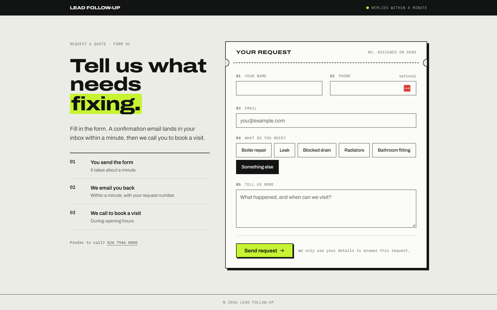
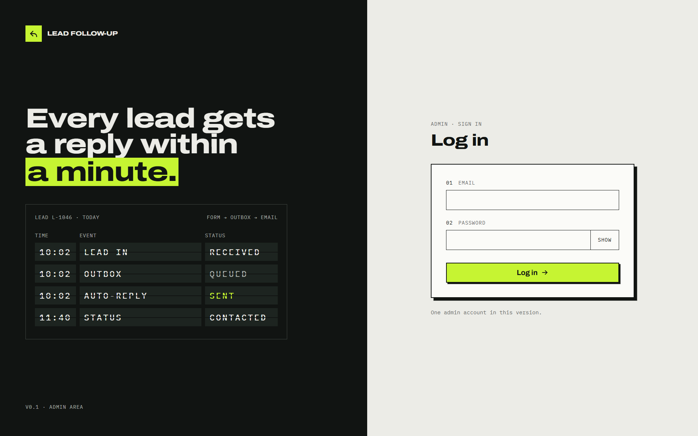
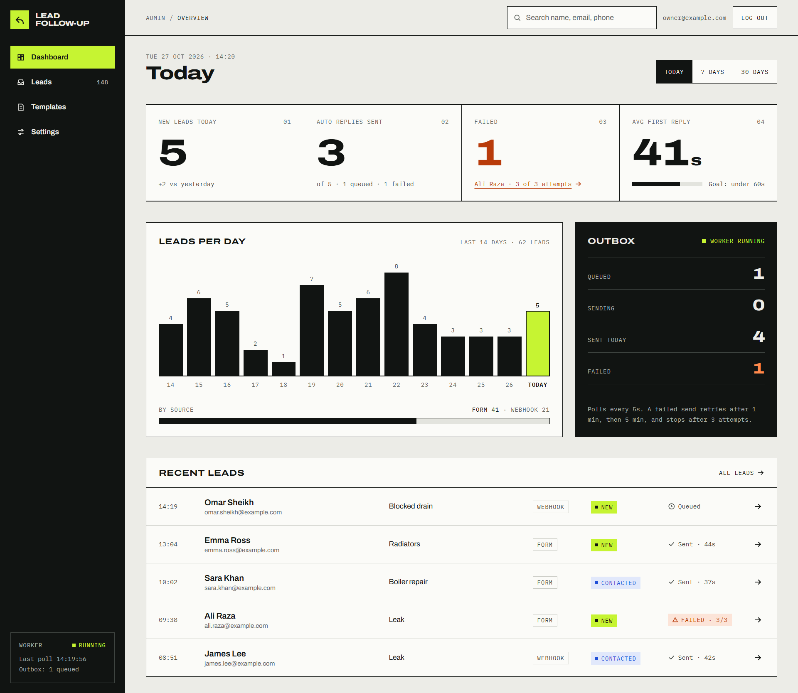
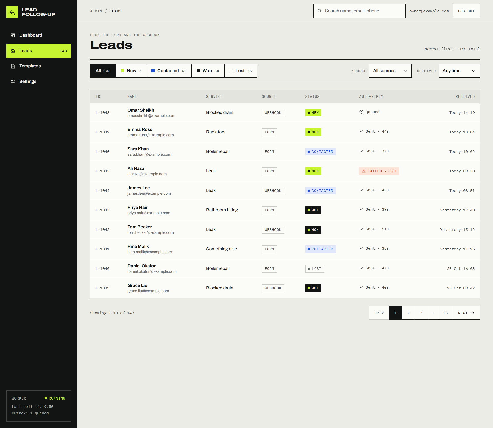

# lead-followup

> **In progress.** v1 is being built. The plan is in [docs/PLAN.md](docs/PLAN.md).

Auto-replies to new leads within a minute and tracks every lead in one dashboard.

## The problem I'm solving

Small service businesses like plumbers, salons, and small agencies get most of their work from enquiries: a website form, a Facebook lead ad, or an email. The owner is usually on a job when one comes in, so the reply goes out hours later or not at all. By then, the customer has often booked whoever answered first.

Speed matters a lot here. A [Harvard Business Review study (2011)](https://hbr.org/2011/03/the-short-life-of-online-sales-leads) of 1.25 million sales leads found that companies that contacted a lead within an hour were nearly 7 times as likely to qualify it as those that tried an hour later, and over 60 times as likely as those that waited a day or more.

What goes wrong today:

- **Late replies.** Leads wait while the owner is busy.
- **Leads in too many places.** Form emails, lead ad tools, and spreadsheets mean some enquiries get missed.
- **No history.** Nobody can see who was contacted, when, and what was sent.
- **Silent failures.** If an email doesn't send, nobody finds out.

What this app does about it:

- Every new lead gets an automatic reply within a minute.
- All leads land in one list with a status: new, contacted, won, or lost.
- Each lead has a timeline of everything that happened to it.
- Emails go through an outbox. A failed send is retried, and if it still doesn't go out, it shows as failed on the dashboard.

## How it works

1. A lead comes in through the public form or a webhook.
2. The API saves the lead and an outbox message in one database transaction.
3. A background worker sends the email and retries up to 3 times if it fails.
4. The dashboard shows every lead and its timeline.

## Planned: urgent leads first

Replying in a minute is automatic. Deciding who to ring back is not, and the leads table sorts by arrival time, so a burst boiler and a bathroom enquiry for next spring look the same in the list.

The next feature classifies each new lead by urgency and job type and sorts the list by it. It runs as a queued job on the same worker as email, so if it is unavailable the lead still lands and the auto-reply still goes out, just without a label. Nothing it produces is sent to a customer.

See [decision 0007](docs/decisions/0007-llm-lead-triage.md).

## Screenshots

<p align="left">
  
  
</p>

<p align="left">
  
  
</p>

## Stack

- **Frontend:** React, Vite, TypeScript, Tailwind CSS, React Router, TanStack Query
- **API:** Express 5, TypeScript, Zod (in progress)
- **Database:** PostgreSQL with plain SQL and versioned migrations (in progress)
- **Worker:** Node process that sends from the outbox with retries (in progress)
- **Triage:** LLM classification of new leads, run as a queued job on the worker (planned)

## Run locally

Requirements: Node 24 and PostgreSQL 15 or newer. All commands run from the repo root.

### 1. Install

```bash
git clone https://github.com/moteeb-asad/lead-followup.git
cd lead-followup
npm install
```

### 2. Create the database

The API connects as its own role, `lead_followup`, never as the `postgres` superuser. That role has no right to create databases, so a superuser creates it and the database once. Open `psql -U postgres` (on Windows, `psql.exe` is in the `PostgreSQL\<version>\bin` folder) or the Query Tool in pgAdmin, and run:

```sql
CREATE ROLE lead_followup LOGIN PASSWORD 'pick-a-password';
CREATE DATABASE lead_followup OWNER lead_followup;
```

The role has to own the database. On PostgreSQL 15 and newer, only the owner can create tables in it, and the migrations need that.

### 3. Set up `apps/api/.env`

```bash
cp apps/api/.env.example apps/api/.env
```

On Windows PowerShell, use `Copy-Item apps/api/.env.example apps/api/.env`. Then edit the three values in `apps/api/.env`:

| Variable         | What to put                                                                                       |
| ---------------- | ------------------------------------------------------------------------------------------------- |
| `DATABASE_URL`   | `postgres://lead_followup:<password>@localhost:5432/lead_followup`, with the password from step 2 |
| `ADMIN_EMAIL`    | The email you will log in to the dashboard with                                                   |
| `ADMIN_PASSWORD` | The dashboard password, at least 12 characters. It is only read once, in step 5.                  |

If the database password has special characters, URL-encode them in `DATABASE_URL` (`@` becomes `%40`). `.env` is git-ignored. Never commit it.

### 4. Create the tables

```bash
npm run db:migrate -w apps/api
```

You should see:

```
applied 0001_create_users.sql
applied 0002_create_sessions.sql
applied 0003_create_leads.sql
migrations up to date
```

The command is safe to run again. It only applies migrations that haven't run yet. Don't paste the SQL files into pgAdmin by hand: the command also records each migration in `schema_migrations`, which is how it knows what has run ([decision 0005](docs/decisions/0005-numbered-sql-migrations.md)).

### 5. Create the first user

```bash
npm run user:create -w apps/api
```

This reads `ADMIN_EMAIL` and `ADMIN_PASSWORD`, hashes the password with argon2id, and adds the user. You should see `Created you@example.com (id 1)`. Then **delete the `ADMIN_PASSWORD` line from `apps/api/.env`**: it isn't needed again.

### 6. Start the app

Run these in two terminals:

```bash
npm run dev:api    # http://localhost:4000
npm run dev:web    # http://localhost:5173
```

- [http://localhost:5173/admin/login](http://localhost:5173/admin/login): log in with `ADMIN_EMAIL` and the password from step 3
- [http://localhost:5173/form](http://localhost:5173/form): public form
- [http://localhost:5173/api/health](http://localhost:5173/api/health): should return `{"status":"ok","database":"up"}`

### If something goes wrong

| You see                                                   | Why, and what to do                                                                                                           |
| --------------------------------------------------------- | ----------------------------------------------------------------------------------------------------------------------------- |
| `DATABASE_URL is not set`                                 | `apps/api/.env` is missing or is in the wrong folder. It goes in `apps/api/`, not the repo root.                              |
| `password authentication failed for user "lead_followup"` | The password in `DATABASE_URL` doesn't match step 2. Reset it with `ALTER ROLE lead_followup PASSWORD '...';` as a superuser. |
| `permission denied for schema public`                     | `lead_followup` doesn't own the database. As a superuser: `ALTER DATABASE lead_followup OWNER TO lead_followup;`              |
| `ADMIN_PASSWORD must be at least 12 characters`           | Use a longer password in `.env`, then run step 5 again.                                                                       |
| `you@example.com already exists`                          | The user is already created. Log in with the password you used the first time.                                                |
| `/api/health` returns `"database":"down"`                 | The API can't reach PostgreSQL. Check that it's running and that `DATABASE_URL` is right.                                     |
| `Too many login attempts`                                 | After 10 wrong passwords, login is locked for 15 minutes. Restarting `npm run dev:api` clears the count.                      |

## Project docs

- [docs/PLAN.md](docs/PLAN.md): current scope and build order
- [docs/decisions/](docs/decisions/): why it's built this way
- [CHANGELOG.md](CHANGELOG.md): what changed in each version
- [AGENTS.md](AGENTS.md): rules for AI coding agents working in this repo
