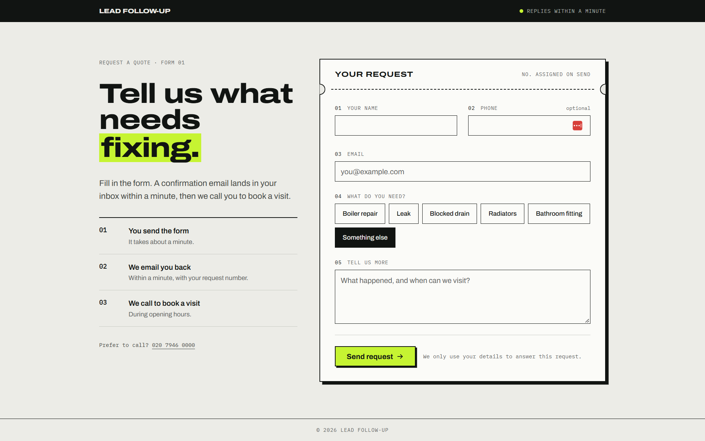
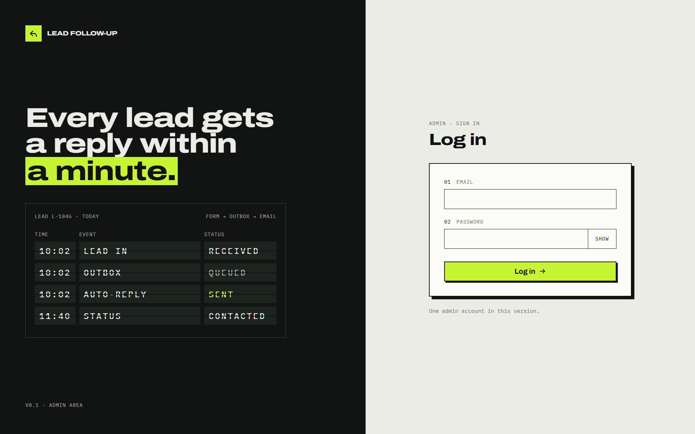
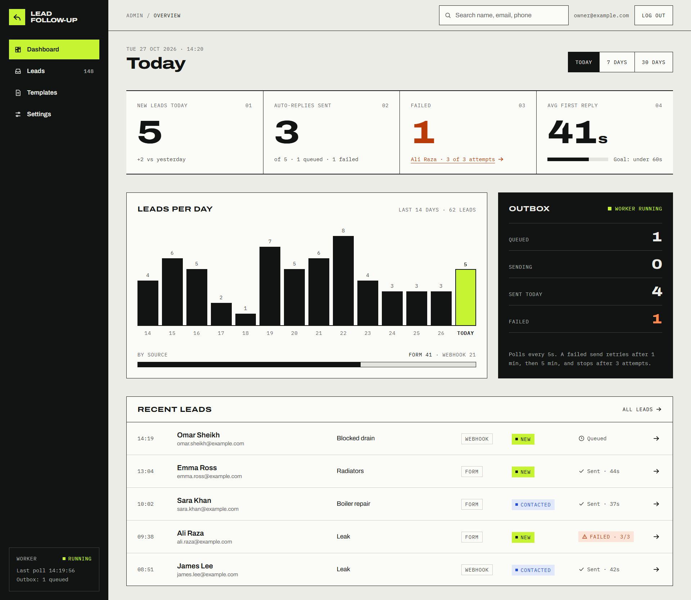
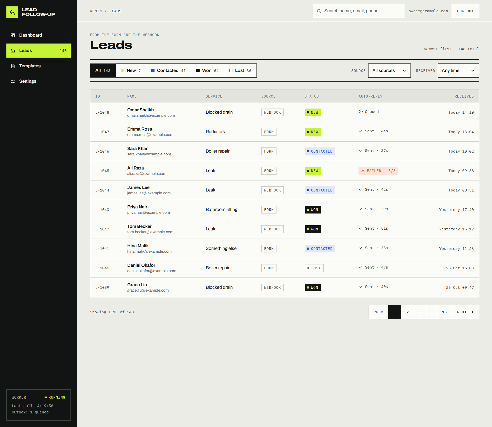

# lead-followup

> **In progress.** v1 is being built. The plan is in [docs/PLAN.md](docs/PLAN.md).

Auto-replies to new leads within a minute and tracks every lead in one dashboard.

## The problem I'm solving

Small service businesses like plumbers, salons, and small agencies get most of their work from enquiries: a website form, a Facebook lead ad, or an email. The owner is usually on a job when one comes in, so the reply goes out hours later or not at all. By then, the customer has often booked whoever answered first.

Speed matters a lot here. A [Harvard Business Review study (2011)](https://hbr.org/2011/03/the-short-life-of-online-sales-leads) of 1.25 million sales leads found that companies that contacted a lead within an hour were nearly 7 times as likely to qualify it as those that tried an hour later, and over 60 times as likely as those that waited a day or more.

What goes wrong today:

- **Late replies.** Leads wait while the owner is busy.
- **Leads in too many places.** Form emails, lead ad tools, and spreadsheets mean some enquiries get missed.
- **No history.** Nobody can see who was contacted, when, and what was sent.
- **Silent failures.** If an email doesn't send, nobody finds out.

What this app does about it:

- Every new lead gets an automatic reply within a minute.
- All leads land in one list with a status: new, contacted, won, or lost.
- Each lead has a timeline of everything that happened to it.
- Emails go through an outbox. A failed send is retried, and if it still doesn't go out, it shows as failed on the dashboard.

## How it works

1. A lead comes in through the public form or a webhook.
2. The API saves the lead and an outbox message in one database transaction.
3. A background worker sends the email and retries up to 3 times if it fails.
4. The dashboard shows every lead and its timeline.

## Screenshots

<p align="left">
  
  
</p>

<p align="left">
  
  
</p>

## Stack

- **Frontend:** React, Vite, TypeScript, Tailwind CSS, React Router, TanStack Query
- **API:** Express 5, TypeScript, Zod (in progress)
- **Database:** PostgreSQL with plain SQL and versioned migrations (in progress)
- **Worker:** Node process that sends from the outbox with retries (in progress)

## Run locally

Requirements: Node 24. PostgreSQL is needed once the API lands.

```bash
npm install
npm run dev:web
```

Then open [http://localhost:5173/form](http://localhost:5173/form) (public form) and [http://localhost:5173/admin](http://localhost:5173/admin) (dashboard).

## Project docs

- [docs/PLAN.md](docs/PLAN.md): current scope and build order
- [docs/decisions/](docs/decisions/): why it's built this way
- [CHANGELOG.md](CHANGELOG.md): what changed in each version
- [AGENTS.md](AGENTS.md): rules for AI coding agents working in this repo
